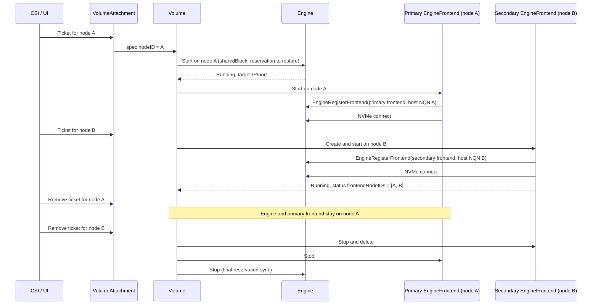
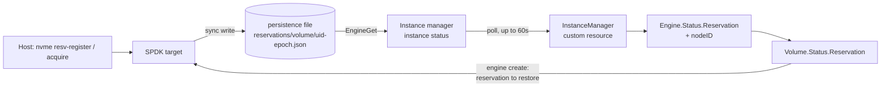
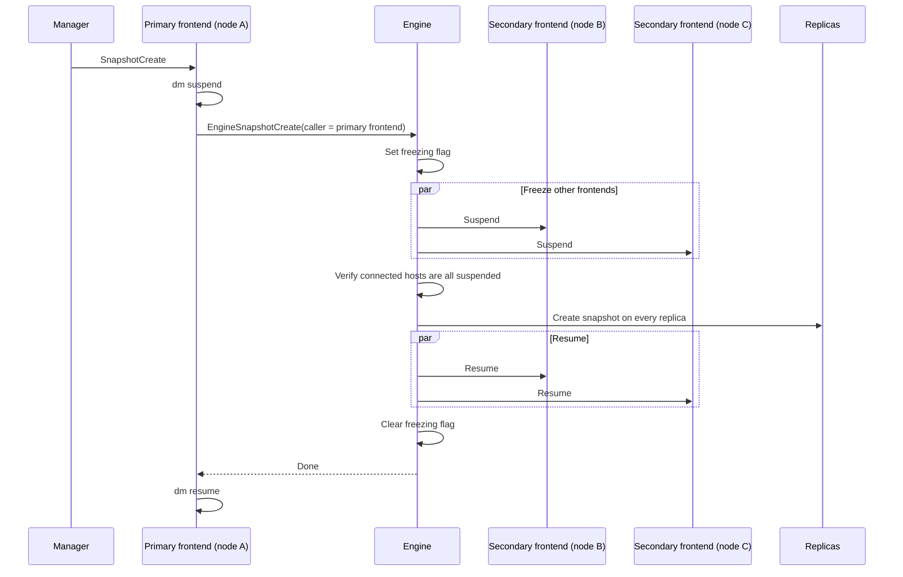
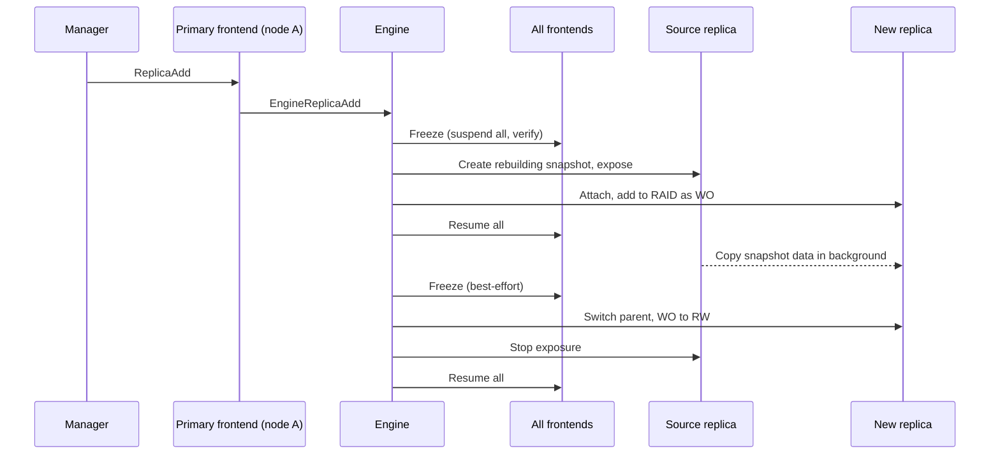
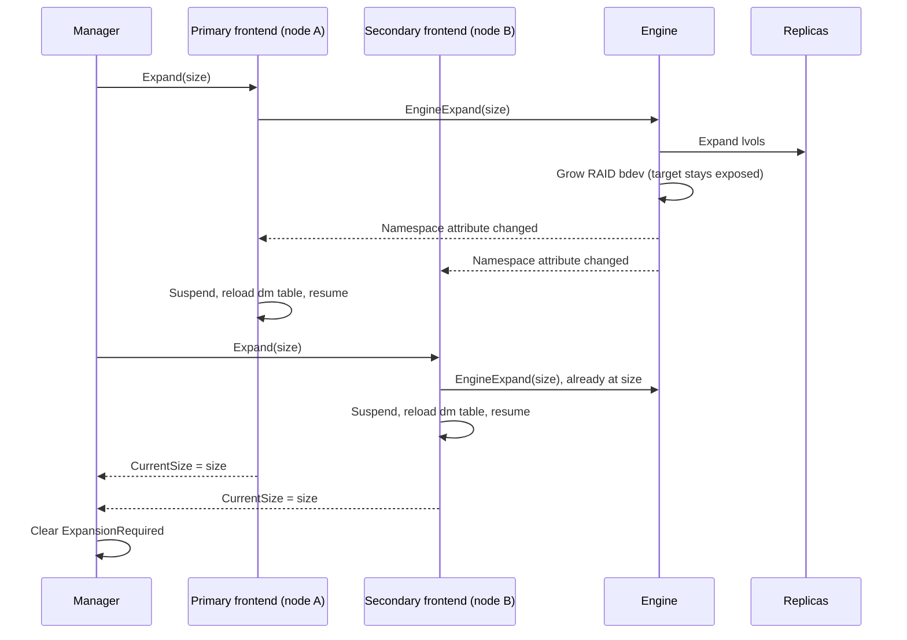
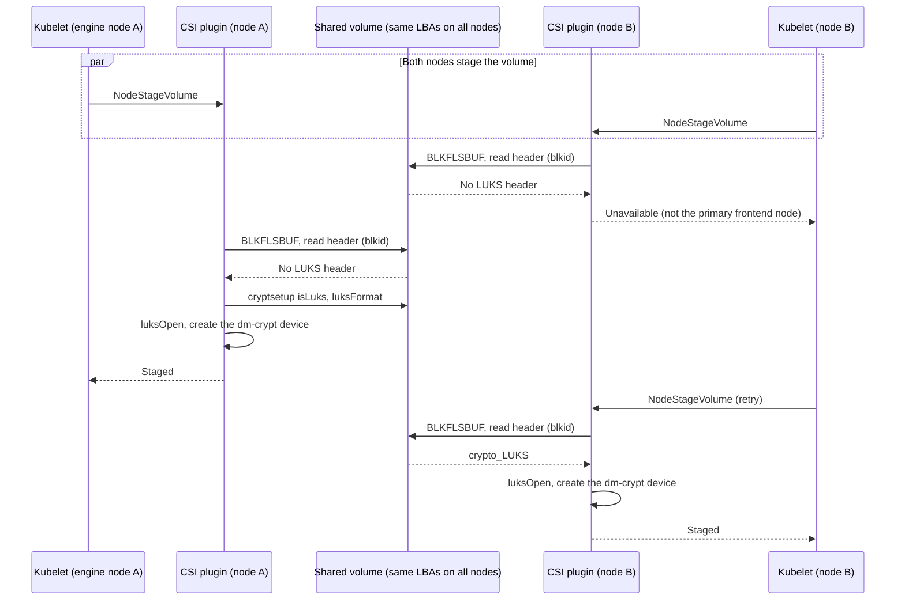

# V2 Shared Block Volume with NVMe Reservation

## Summary

This proposal adds shared block volumes to the v2 data engine. A shared block volume is a `ReadWriteMany` block volume that can be attached to multiple nodes at the same time. All nodes connect to a single engine target through NVMe/TCP, so they see the same data and the same NVMe reservation state.

NVMe Reservation is the NVMe equivalent of SCSI-3 Persistent Reservation. Clustered applications (for example, guest clusters such as Windows Server Failover Clustering, or Linux HA stacks) use it to decide which node may write to a shared disk and to fence a failed node. Longhorn does not issue reservation commands on behalf of applications. Longhorn provides:

- Multi-node read/write access to one v2 volume.
- A single, consistent NVMe reservation state for all attached nodes, served by the SPDK NVMe-oF target.
- Persistence of the reservation state across engine and instance-manager restarts, and detach and re-attach, including re-attaching with the engine on another node.
- Consistent data operations (snapshot and replica rebuilding) while multiple nodes are writing.

Longhorn provides multi-node read/write access; write arbitration among nodes is the application's responsibility via NVMe Reservation.

### Terminology

This document uses the following terms:

- **Workload live migration**: the workload, for example a KubeVirt VM, moves from one node to another while it keeps using the volume. This is what the user or KubeVirt does.
- **Engine migration**: the mechanism Longhorn uses for a migratable volume to serve a workload live migration: a second engine runs on the target node, and the volume switches to it when the migration completes. A shared block volume serves a workload live migration without engine migration.
- **Engine switchover**: the running engine of an attached volume moves to another node, for example during an instance-manager live upgrade.

### Related Issues

- https://github.com/longhorn/longhorn/issues/12055
- https://github.com/longhorn/longhorn/issues/14274

## Motivation

Clustered applications, for example Windows Server Failover Clustering in guest VMs or Linux HA stacks, run on several nodes and share one disk. They use NVMe Reservation, or SCSI-3 Persistent Reservation, to decide which node may write to the disk and to fence a failed node. Longhorn cannot serve these applications today:

- Longhorn does not support NVMe Reservation. The SPDK NVMe-oF target already implements it, including persistence through power loss with a `ptpl_file`, but Longhorn does not use it, and does not keep the reservation state when the engine restarts or runs on another node.
- A reservation only works if every node sees the same reservation state, so all nodes must use the same target at the same time. Longhorn has no such volume. Neither kind of `ReadWriteMany` volume is a shared block device:
  - A regular RWX volume is served by the share-manager over NFS. It supports the `Filesystem` volume mode only, and only one node is attached at the block layer.
  - A migratable volume is attached to a second node only during a workload live migration, through engine migration. Each node connects to its own engine, so the two nodes do not share one reservation state, and there is only one writer.

To support clustered applications, Longhorn needs to support NVMe Reservation, and therefore a shared block volume: a block volume attached to all cluster nodes at the same time, where every node connects to one engine target and sees one reservation state that Longhorn keeps across restarts and re-attach.

### Goals

- Support `ReadWriteMany` block volumes on the v2 data engine that can be attached to multiple nodes at the same time.
- Serve all attached nodes with a single engine target, so that all nodes see one NVMe reservation state.
- Persist the NVMe reservation state across engine and instance-manager restarts, and detach and re-attach, including re-attaching with the engine on another node. Only deleting the volume clears it.
- Keep replicas consistent when snapshot creation and replica rebuilding happen while multiple nodes are writing.
- Support workload live migration without engine migration: the target node is attached as another node of the same engine.
- Report the reservation state in the `Volume` status and warn when the volume is shared without a reservation.
- Support the v2 data paths that do not depend on the number of attached nodes: backup, restore, clone, revert, and disaster recovery volumes.

### Non-goals

- Engine high availability. A shared block volume has exactly one engine. Engine migration and engine switchover, including the one during an instance-manager live upgrade, are not supported for shared block volumes.
- The v1 data engine and SCSI-3 Persistent Reservation.
- Issuing reservation commands (register, acquire, preempt, release, clear) on behalf of applications.
- Coordinating writes among nodes. Applications without NVMe Reservation or a cluster lock manager can corrupt data, the same as with a shared LUN on a SAN.
- Translating SCSI Persistent Reservation in a guest to NVMe Reservation. This belongs to the virtualization layer (for example, Harvester or KubeVirt).
- The `ublk` and `nvmf` frontends, sharded volumes, and `strict-local` data locality for shared block volumes.

## Proposal

### User Stories

#### Story 1: Guest cluster on a shared disk

Before this enhancement, a user cannot give one Longhorn volume to several VMs or pods on different nodes as a raw block device. Users of clustered applications need external SAN storage.

After this enhancement, the user creates a v2 volume with `sharedBlock: true` and attaches it to every cluster node. The application registers each node and acquires a reservation through NVMe Reservation. When a node fails, the application preempts the failed node's registration, and the failed node can no longer write.

#### Story 2: Reservation survives maintenance

A user restarts the instance-manager on the engine node, or detaches and re-attaches the volume, possibly to a different set of nodes. The registrations and the reservation holder are still present afterwards, so the application does not lose fencing (fail-open) after maintenance.

#### Story 3: Data protection while shared

A user creates snapshots and backups of a shared block volume, and Longhorn rebuilds a failed replica, while all nodes keep writing. The snapshot is crash-consistent across all replicas, and no node sees I/O errors.

### User Experience In Detail

1. Create a StorageClass with `sharedBlock: "true"`:

    ```yaml
    kind: StorageClass
    apiVersion: storage.k8s.io/v1
    metadata:
      name: longhorn-v2-shared-block
    provisioner: driver.longhorn.io
    allowVolumeExpansion: true
    parameters:
      dataEngine: "v2"
      sharedBlock: "true"
      numberOfReplicas: "3"
    ```

2. Create a PVC with `accessModes: [ReadWriteMany]` and `volumeMode: Block`, and use it from workloads on multiple nodes. Each node gets `/dev/longhorn/<volume>`.

3. Alternatively, create the volume in the UI or API with `Shared Block` checked (v2 only). The UI sets `ReadWriteMany` and the `blockdev` frontend. The volume can be attached to multiple nodes from the UI; each node uses its own attachment ticket.

4. The application uses `nvme resv-register`, `nvme resv-acquire`, `nvme resv-report`, and so on against the NVMe namespace device (`/dev/nvmeXnY`), or the kernel block persistent reservation ioctls (`IOC_PR_*`). To persist the reservation state, a host must turn on persistence when it registers (`--cptpl=3` in `nvme-cli`; the kernel `IOC_PR_REGISTER` path always does). Persistence applies to the whole namespace, see [Persist Through Power Loss in SPDK](#persist-through-power-loss-in-spdk). See [NVMe Reservation Commands](#nvme-reservation-commands).

5. `kubectl -n longhorn-system get volumes.longhorn.io <volume> -o yaml` shows:
    - `status.frontendNodeIDs`: the nodes the volume is available on.
    - `status.reservation`: the persisted reservation state.
    - The `UnreservedSharedAccess` condition, which is `True` when the volume is available on more than one node and no host holds a persisted reservation.

Requirements and limitations:

- Each node must have a unique NVMe host ID (`/etc/nvme/hostid`). Cloned nodes may share the same DMI product UUID.
- If no host has turned on persistence, or a host turned it off (`--cptpl=2`), the registrations and the reservation are lost when the engine restarts.
- A shared block volume supports up to 16 attached nodes, the number of controller IDs of the engine target. Longhorn does not reject more attachments, but the frontend on a 17th node fails to connect.
- Longhorn does not switch the engine over to another node while the volume is attached:
  - Draining the engine node is blocked, by the PodDisruptionBudget of its instance-manager, until the volume is detached from all nodes. Draining another node removes the frontend on that node only, after its workloads are evicted.
  - An instance-manager live upgrade fails on every node the volume is attached to. Detach the volume first.
- If the engine node is permanently lost, reservation changes made after the last sync to the cluster (up to about 60 seconds) are lost.
- Applications that use a distributed lock manager instead of NVMe Reservation (for example, GFS2 or OCFS2) work, but `UnreservedSharedAccess` stays `True`, and they need power fencing.

#### NVMe Reservation Commands

On each attached node, `/dev/longhorn/<volume>` is a device-mapper device on top of the NVMe namespace. `nvme-cli` reservation commands must be sent to the NVMe namespace device, whose name can differ between nodes:

```shell
# Find the NVMe namespace device (for example, nvme1n1) under /dev/longhorn/<volume>
dmsetup deps -o devname /dev/longhorn/<volume>

# Register key 0xa1 with persistence, acquire Write Exclusive, and show the reservation state
nvme resv-register /dev/nvme1n1 --namespace-id=1 --nrkey=0xa1 --rrega=0 --cptpl=3
nvme resv-acquire  /dev/nvme1n1 --namespace-id=1 --crkey=0xa1 --rtype=1 --racqa=0
nvme resv-report   /dev/nvme1n1 --namespace-id=1 --eds -o json
```

For the commands, reservation types, and their behavior, see:

- NVM Express Base Specification, Reservations: https://nvmexpress.org/specifications/
- `nvme-cli`: [resv-register](https://github.com/linux-nvme/nvme-cli/blob/master/Documentation/nvme-resv-register.txt), [resv-acquire](https://github.com/linux-nvme/nvme-cli/blob/master/Documentation/nvme-resv-acquire.txt), [resv-release](https://github.com/linux-nvme/nvme-cli/blob/master/Documentation/nvme-resv-release.txt), [resv-report](https://github.com/linux-nvme/nvme-cli/blob/master/Documentation/nvme-resv-report.txt)
- SPDK NVMe-oF target: https://spdk.io/doc/nvmf.html

### API Changes

#### Volume CRD

```go
type VolumeSpec struct {
    // sharedBlock allows the RWX block volume to be attached to multiple nodes
    // at the same time. Only supported by the v2 data engine. Immutable.
    SharedBlock bool `json:"sharedBlock"`
}

type VolumeStatus struct {
    // frontendNodeIDs lists the nodes with a running engine frontend.
    FrontendNodeIDs []string `json:"frontendNodeIDs"`
    // reservation is the persisted NVMe reservation state.
    Reservation *VolumeReservation `json:"reservation"`
}

type VolumeReservation struct {
    Epoch        int64                         `json:"epoch"`  // increases when the engine moves to another node
    NodeID       string                        `json:"nodeID"` // engine node of this epoch
    Type         int                           `json:"type"`   // 1 to 6, or 0 if no reservation
    HolderKey    string                        `json:"holderKey"`
    HolderHostID string                        `json:"holderHostID"`
    Registrants  []VolumeReservationRegistrant `json:"registrants"`
}
```

- New volume condition `UnreservedSharedAccess` (reason `NoReservation`).
- `Engine.Status.Reservation` and `InstanceManager.Status.InstanceEngines[].Status.Reservation` carry the state reported by the engine.
- Reservation keys, including `holderKey`, are stored in plain text because they are not secrets:
  - Any host connected to the target can read all keys with Reservation Report, without registering.
  - A key does not authenticate a host. It only coordinates the hosts, and a host must be registered on a connected controller to preempt with another host's key. Access is controlled by the NVMe connection.
  - Applications usually derive keys from node identities.
  - A user who can read `Volume.Status` can usually also attach or detach the volume.

#### Longhorn API

- `Volume.sharedBlock` and `Volume.frontendNodeIDs` are added.
- `Volume.controllers` of a shared block volume has one entry per attached node. The first entry is the engine node; each entry carries the endpoint on its node. The UI, the CSI plugin, and recurring jobs treat these entries as frontends of one engine, not as multiple engines.
- Trimming the filesystem is rejected for a shared block volume.

Webhook rules for `spec.sharedBlock: true`:

| Field | Rule |
| --- | --- |
| `dataEngine` | Must be `v2` |
| `accessMode` | Must be `rwx` |
| `frontend` | Must be `blockdev` (empty is allowed for standby volumes) |
| `dataLocality` | Must not be `strict-local` |
| `dataLayout` | Must not be sharded |
| `migratable` | Allowed, ignored. There is no engine migration; a workload live migration attaches the target node as another node. |

#### Instance manager and SPDK gRPC

- `shared_block` is added to the engine and engine frontend create requests and to the instance spec.
- `ReservationState` is added to the engine create request (the state to restore) and to the engine status (the state the target persists). It carries the volume UID, which binds the persisted state to one volume lifetime.
- `EngineReservationCleanup` (SPDK) and `InstanceReservationCleanup` (instance manager) remove the persisted reservation state of a deleted volume.
- `EngineRegisterFrontend` registers an engine frontend with the engine so the engine can suspend all frontends.
- `SnapshotRequest.engine_frontend_name` tells the engine which frontend initiated a snapshot and is already suspended.

## Design

### Implementation Overview

#### High-Level View

Every attached node is an NVMe/TCP initiator that connects to the same NVMe-oF target in the single engine. The target keeps one namespace and one reservation state for all nodes.

```text
+-----------+   +-----------+   +-----------+
|  Node A   |   |  Node B   |   |  Node C   |
| initiator |   | initiator |   | initiator |
+-----+-----+   +-----+-----+   +-----+-----+
      |               |               |
      +----------- NVMe/TCP ----------+
                      |
                      v
         +-------------------------+
         | Engine (NVMe-oF target) |
         | one namespace           |
         | NVMe reservation        |
         +------------+------------+
                      |
                      v
                  Replicas
```

#### Object Model

A shared block volume has one `Engine` and one `EngineFrontend` per attached node:

- The primary `EngineFrontend` `<volume>-ef-0` is `Active` and runs on the engine node. Like the single frontend of a regular v2 volume, it is the frontend through which the manager runs snapshot operations, expansion, and clones from the volume, and it decides whether the volume is attached. Replica rebuilding can go through any running frontend, because the engine freezes all frontends.
- A secondary `EngineFrontend` `<volume>-ef-shared-<node hash>` (`Active=false`) runs on every other attached node.

```text
                          +-----------------------------+
                          |            Volume           |
                          |-----------------------------|
                          | spec.sharedBlock = true     |
                          | status.frontendNodeIDs      |
                          | status.reservation (epoch)  |
                          +--------------+--------------+
                                         |
            +----------------------------+----------------------------+
            |                            |                            |
            v                            v                            v
+------------------------+   +------------------------+   +------------------------+
| EngineFrontend         |   | EngineFrontend         |   | EngineFrontend         |
| <volume>-ef-0          |   | <volume>-ef-shared-x   |   | <volume>-ef-shared-y   |
| node A (primary)       |   | node B (secondary)     |   | node C (secondary)     |
| /dev/longhorn/<volume> |   | /dev/longhorn/<volume> |   | /dev/longhorn/<volume> |
+-----------+------------+   +-----------+------------+   +-----------+------------+
            | NVMe/TCP (host NQN A)      | NVMe/TCP (host NQN B)      | NVMe/TCP (host NQN C)
            +----------------------------+----------------------------+
                                         |
                                         v
                         +-------------------------------+
                         | Engine (node A)               |
                         |-------------------------------|
                         | one NVMe-oF subsystem         |
                         | one namespace                 |
                         | 16 controller IDs             |
                         | NVMe reservation              |
                         | persistence file (ptpl_file)  |
                         | registered frontends          |
                         +---------------+---------------+
                                         |
                                         v  RAID1
           +----------------+   +----------------+   +----------------+
           |   Replica 1    |   |   Replica 2    |   |   Replica 3    |
           +----------------+   +----------------+   +----------------+
```

All I/O from all nodes goes through the single engine, so there is one ordering point for writes and one reservation state. Each node keeps its own device-mapper device on top of the NVMe namespace, as with RWO v2 volumes, so I/O can be queued on each node by `dm suspend`.

#### Attach and Detach

The desired set of frontend nodes comes from the `VolumeAttachment` tickets. No new attach API is added: CSI and the UI use the existing attach and detach APIs, and the UI uses one attachment ID per node (`longhorn-ui-<node>`) for shared block volumes.

- The engine node is the node of the first ticket (`Volume.Spec.NodeID`). The engine and the primary frontend stay on this node while any ticket matching the attachment parameters of the volume (`disableFrontend`) exists on any node, even if the ticket of this node is removed.
- The detach decision is otherwise the same as for a regular volume. When only interruptible tickets match (snapshot, backup, or clone), a workload ticket on another node with incompatible parameters interrupts them and the volume is detached, so it can be attached again for the workload. A workload ticket with incompatible parameters is not satisfied while the volume stays attached, with the same `AttachedWithIncompatibleParameters` reason.
- `reconcileSharedBlockEngineFrontends` creates and deletes secondary frontends to match the workload tickets (`longhorn-api` and `csi-attacher`) with the frontend enabled on other nodes. Secondary frontends exist only while the volume is attached with the frontend enabled and the engine is running: they are deleted when the engine stops, for example when it restarts, and created again when it runs. New secondary frontends are not created while expansion is in progress.
- The volume is fully detached when no matching ticket remains. Detach order is the same as v2 RWO: frontends, then the engine, then replicas.



#### NVMe Target Configuration

- One NVMe-oF subsystem and one namespace per engine, as with RWO v2 volumes. NQN, NGUID, and namespace UUID are derived from the volume name.
- A shared block engine allows a range of 16 controller IDs, derived from the target address, instead of a single one. Each connected host gets its own controller.
- The registrant identity is the NVMe host ID, so every node must have a unique host ID.
- The namespace is added with a `ptpl_file`, so SPDK persists the reservation state on every change before it completes the command.

#### Reservation Persistence

##### Persist Through Power Loss in SPDK

NVMe defines Persist Through Power Loss (PTPL) for the reservation state. SPDK implements it with a `ptpl_file` per namespace:

- A namespace supports PTPL only if it is added with a `ptpl_file`. Otherwise a register command that turns on persistence fails with Invalid Field.
- PTPL is one setting for the whole namespace, not for each registration. A register command with `CPTPL=3` turns it on, `CPTPL=2` turns it off, and `CPTPL=0` keeps it. While it is on, all registrations and the reservation are persisted, including the registrations of hosts that did not ask for persistence.
- While PTPL is on, SPDK rewrites the whole file on every change (register, unregister, acquire, preempt, release, and clear) before it completes the command. If the write fails, the command completes with Internal Device Error. Turning PTPL off empties the file.
- SPDK does not write the file atomically: it truncates the file and then writes it, so a crash in between leaves an empty file.
- The file is JSON:

    ```json
    {
      "ptpl": true,
      "rtype": 1,
      "crkey": 161,
      "bdev_uuid": "<UUID of the namespace bdev>",
      "holder_uuid": "<host ID of the holder>",
      "registrants": [
        {"rkey": 161, "host_uuid": "<host ID of node A>"},
        {"rkey": 177, "host_uuid": "<host ID of node B>"}
      ]
    }
    ```

    Longhorn maps it to the reservation state, for example `Volume.Status.Reservation`: `rtype` to `type`, `crkey` to `holderKey`, `holder_uuid` to `holderHostID`, and each registrant to `key` and `hostID`. A file with `ptpl` false or no registrants means no reservation state.
- When the namespace is added, SPDK loads the file and restores the registrations and the reservation before it accepts I/O. A missing file, or a file with `ptpl` false or no registrants, restores nothing, so PTPL stays off until a host turns it on again. Adding the namespace fails if SPDK cannot parse the file, if `bdev_uuid` is not the UUID of the namespace bdev, or if the holder key is not registered.

Longhorn builds on this as follows:

- The namespace bdev of a shared block engine has a stable UUID derived from the volume name, so a file stays valid after the engine is recreated on any node.
- The spdk-engine checks a file with the same rules as SPDK before it adds the namespace, so it can replace a file SPDK cannot restore with the synced state, instead of failing the engine.
- The spdk-engine writes a file atomically (a temporary file, `fsync`, then rename).

##### Two Levels of Persistence

The `ptpl_file` gives the persistence semantics NVMe requires, but it alone is not enough, because it lives on the engine node, and the engine may run on a different node after re-attach. So the state is kept at two levels:

- **Local persistence file**: `<metadataDir>/reservations/<volume>/<volumeUID>-<epoch>.json` on the engine node. It is the most recent state for the current epoch. The volume UID in the name makes sure a new volume with the same name never restores the state of a deleted one.
- **`Volume.Status.Reservation`**: the cluster-wide source of truth, used to restore the state on another node or when the local file is missing or corrupted.

The engine reports the state only from a valid file or a missing one. An empty or partially written file is reported as unknown, so the synced state is kept.

The epoch identifies a generation of the state. It increases when the engine starts on a node different from the node of the last known state.



When the engine is created:

1. The engine controller picks the newer of `Volume.Status.Reservation` and `Engine.Status.Reservation`. If the engine node equals its `nodeID`, the epoch is kept; otherwise the epoch is increased by one.
2. The spdk-engine keeps a valid local persistence file of the same epoch, because it is never older than the cluster state (for example, after an instance-manager crash). Otherwise it writes the file from the state passed by the manager. An empty file is not valid: SPDK truncates the file before writing it, so a crash may leave it empty while a reservation is active. If the state passed by the manager is not valid, the engine fails instead of exposing the volume without the reservation. Files of other epochs or other volume UIDs are removed.
3. The namespace is added with the persistence file, and SPDK restores the registrations and the reservation before accepting I/O.

When the volume is detached normally, the engine controller reads the state once more before deleting the engine, so the state includes all changes. If the engine node fails, the restored state may miss changes from the last seconds before the failure. Restoring a slightly old state is still safer than starting with no reservation.

The state is cleared only when the volume is deleted:

- `Volume.Status.Reservation` is deleted with the volume custom resource.
- Before the volume finalizer is removed, after the engine, engine frontend, and replica custom resources are gone, the volume controller calls `InstanceReservationCleanup` on the instance manager of `Volume.Status.Reservation.nodeID`, the last engine node. The spdk-engine removes `<metadataDir>/reservations/<volume>/`, and rejects the request while an engine of the volume still exists.
- The cleanup cannot run when the engine is deleted. After a detach, the engine custom resource no longer has a node or instance manager, and the SPDK engine is already stopped.
- The cleanup is best effort. A failure is logged and never blocks the volume deletion, because a leftover file is bound to the old volume UID and is removed when an engine of a new volume with the same name starts on that node.

#### Consistent Data Operations Across Frontends

For an RWO v2 volume, the single frontend suspends its device-mapper device during snapshot creation and replica rebuilding, so no I/O is in flight while the replicas are changed. For a shared block volume, the other nodes would keep writing, and the replicas could be snapshotted at different I/O points.

The engine therefore coordinates all frontends. This is called a freeze:

- **Frontend registry**: each shared block frontend registers `{name, address, hostNQN}` with the engine before connecting, and re-registers every 30 seconds while running or suspended, so the registry is rebuilt after an engine restart. A frontend that an engine restart leaves suspended is resumed by the next freeze. A frontend whose instance-manager restarts while its device is suspended recovers as suspended, so that the engine resume, or the next freeze if the resume failed meanwhile, resumes the device.
- **Freeze**: the engine rejects new connections to the subsystem, then suspends the registered frontends of the connected hosts in parallel (`dm suspend`), without holding the engine lock. Hosts that are not connected cannot connect until the freeze ends, so their frontends are skipped. Frontend I/O is queued in device-mapper on each node. The NVMe connections, including keep-alive, are not affected, so there is no timeout during a long operation.
- **Verification**: the engine checks that every host connected to the subsystem (`nvmf_subsystem_get_controllers`) belongs to a suspended frontend. Otherwise, it resumes the suspended frontends and fails the operation. The manager retries.
- **Exclusion**: snapshot creation, replica add, and frontend registration share one freezing flag. A second operation fails immediately instead of waiting, which avoids deadlocks between the engine and frontends. New frontends cannot connect during a freeze.
- **Resume**: all frontends are resumed when the operation finishes or fails.

The SPDK subsystem pause and RAID bdev quiesce were considered and rejected. Subsystem pause also queues admin commands, so hosts reconnect after the 5-second keep-alive timeout and fail I/O after the fast I/O fail timeout. RAID quiesce is used internally by SPDK RAID operations and can deadlock with them.

##### Snapshot Creation

Snapshot creation is sent only to the primary frontend, as with RWO volumes.



##### Replica Rebuilding

Replica rebuilding adds a new replica to the RAID1 bdev and copies data from a healthy replica. The synchronous part of `ReplicaAdd` (creating the rebuilding snapshot, exposing the source, attaching the new replica, and growing the RAID with the new replica in `WO` mode) runs inside a freeze of all frontends. After the data is copied in the background, the finishing part (switching the snapshot parent, stopping the exposure, and changing the replica from `WO` to `RW`) runs inside another freeze. As in the RWO flow, the finishing freeze is best-effort. The manager sends `ReplicaAdd` through a running frontend of the engine, usually the primary one; the engine freezes all frontends either way.



##### Expansion

Expansion does not need a freeze. The engine grows the RAID bdev in place, and the target and the NVMe connections stay up. Unlike a snapshot, expansion does not capture a point in time across the replicas: all writes from all nodes go through the same RAID1 bdev to every replica, data within the old size is not changed, and the new space cannot be used until the RAID bdev has grown. This is the same as for an RWO v2 volume, whose host also keeps writing during expansion.

1. The manager requests expansion through every ready frontend.
2. The first `EngineExpand` expands the replicas and grows the RAID bdev. Later calls find the engine at the new size and return.
3. SPDK sends a namespace attribute changed notice to every connected controller, so the kernel on each node updates the size of the NVMe namespace.
4. Each frontend suspends its own device-mapper device, reloads the table with the new size, and resumes it. As the resume would release a freeze, a frontend rejects a snapshot request and a suspension by the engine while it expands, and the freeze fails and is retried.
5. The manager clears `ExpansionRequired` only after every ready frontend reports the new size (`isEngineFrontendServingVolumeSize`). New secondary frontends are not created during expansion, so a node that attaches during expansion waits until it finishes.



The hosts stay connected, so registrations without persistence are kept. Until a node reloads its device-mapper table, it still sees the old size. When to use the new space is up to the application, the same as when a shared LUN on a SAN is expanded.

Through CSI, `ControllerExpandVolume` waits until every frontend reports the new size. For an encrypted volume, the kubelet on each node calls `NodeExpandVolume` to resize its own dm-crypt device, so the nodes may see the new size a few seconds apart. A node that stages the volume after an offline expansion opens dm-crypt at the full size.

#### Encryption

Encryption uses the same `cryptsetup` LUKS2 flow as an RWO block volume. Each node runs its own dm-crypt device (`/dev/mapper/<volume>-encrypted`) on top of its `/dev/longhorn/<volume>`, with the key from the same secret, so all nodes read and write the same ciphertext.

Formatting is the only step that must run once. `NodeStageVolume` handles a device without a LUKS header as follows:

1. Flush the block device buffers before reading the header (`BLKFLSBUF`). Another node may have formatted the device after this node last read it, and the page cache of this node would still show an empty device.
2. Only the node of the primary frontend (the engine node) formats the device.
3. On other nodes, return `Unavailable`, so the kubelet retries until the primary node has formatted the device. A secondary node never uses the raw device.

The CSI plugin also checks the header with `cryptsetup isLuks` right before `luksFormat`, so an existing header is never overwritten.



If node B reads the header while node A is still formatting, `luksOpen` fails and returns an error, and the kubelet retries the same way.

Later operations do not need coordination:

- Re-staging or a node reboot opens the existing header on that node only.
- When the instance-manager restarts, the frontend reloads `/dev/longhorn/<volume>` in place with the same device number, so the dm-crypt device on top of it keeps working.
- Unstaging closes the dm-crypt device on that node only.

Reservation commands go through dm-crypt to the NVMe namespace for register, reserve, release, and preempt. dm-crypt does not pass through the clear command and the NVMe passthrough commands, so `IOC_PR_CLEAR` and `nvme-cli` reservation commands fail with `ENOTTY` on the dm-crypt device. Use `IOC_PR_PREEMPT` instead of clear, or run `nvme-cli` against the NVMe namespace device (`/dev/nvmeXnY`).

#### Other Operations

| Operation | Behavior |
| --- | --- |
| Backup | Uses a snapshot created through the freeze. The backup reads the snapshot from replicas only. |
| Clone from a shared block volume | The source snapshot is created through the freeze. |
| Clone to, restore to, and revert a shared block volume | Run with the frontend disabled, so no host is connected, same as RWO. Secondary frontends are created after the volume is attached for workloads again. |
| Disaster recovery volume (standby) | Supported. Incremental restore runs with the frontend disabled. After activation, the volume can be attached to multiple nodes. |
| Workload live migration (for example, KubeVirt VM live migration) | Supported. The target node is attached as a secondary frontend of the same engine, and the frontend on the source node is removed when the migration completes. The engine and the primary frontend stay on the engine node. |
| Engine migration, engine switchover, instance-manager live upgrade | Not supported. A shared block volume always has one engine. An instance-manager live upgrade fails on every node the volume is attached to. |
| Node drain | Draining the engine node is blocked until the volume is detached from all nodes. Draining another node detaches the volume from that node only, after its workloads are evicted. |
| Trim filesystem | Not supported. A shared block volume has no filesystem managed by Longhorn. |

#### Monitoring

- `status.frontendNodeIDs` lists the nodes with a running frontend.
- `status.reservation` shows the persisted reservation state, synced from the engine within about 60 seconds.
- `UnreservedSharedAccess` is `True`, and a warning event is recorded once, when the volume is available on more than one node and no host holds a reservation. The reservation state comes from the persistence file, so a reservation held while persistence is off is not reported, and the condition stays `True`. Longhorn only reports this; it does not block I/O from unregistered hosts. NVMe defines that all hosts may access the namespace when there is no reservation, and applications such as WSFC register and acquire before they write.

### Test Plan

Unit tests:

- spdk-engine: controller ID range, persistence file encoding and parsing, epoch and volume UID file selection, reservation cleanup, frontend registry, freeze success and failure paths, and snapshot creation with and without a suspended caller.
- manager: webhook validation, attach and detach decisions, secondary frontend reconciliation, epoch calculation, reservation sync, and the `UnreservedSharedAccess` condition.

Integration tests (multiple nodes, v2 data engine):

1. Attach a shared block volume to two nodes, write on one node with `O_DIRECT`, and verify the data on the other node.
2. Reservation: register both hosts with persistence (`--cptpl=3`), acquire Write Exclusive, verify that the other host can read but its writes fail with Reservation Conflict, preempt, release, and repeat with Write Exclusive - All Registrants.
3. Verify that `Volume.Status.Reservation` reflects the state, and `UnreservedSharedAccess` changes after acquire and release. Verify that a reservation acquired with persistence off is not reported.
4. Restart the instance-manager on the engine node and verify that the volume recovers, the registrations and the holder are restored, and the data is unchanged.
5. Detach from all nodes and re-attach on a different engine node. Verify that the epoch increases and the reservation is restored.
6. Create snapshots and rebuild a replica while both nodes write continuously. Verify that every frontend is suspended and resumed, there are no I/O errors, and the replicas are consistent.
7. Expand the volume online through CSI while both nodes write, and offline while detached. Verify the new size on every node and that the reservation is unchanged.
8. Backup, restore to a shared block volume and to a regular volume, clone, revert, and disaster recovery volume activation. Verify the data.
9. Webhook rejections: v1, RWO, non-blockdev frontend, and changing `sharedBlock`.
10. Partial detach: remove the ticket of the engine node or a secondary node, and verify that the remaining nodes keep working.
11. Run the blktests NVMe reservation test (`nvme/054`) against a shared block volume target.
12. Encryption: stage an encrypted volume on two nodes at the same time. Verify that only the engine node formats it, every node sees the same LUKS header and data, reservations work through dm-crypt, and the volume survives re-staging and an instance-manager restart.
13. CSI operations on a plain and an encrypted shared block StorageClass: provision, publish to two nodes, unpublish one node, expansion, VolumeSnapshot, restore from snapshot and backup, clone, and delete. Verify that a filesystem-mode PVC is rejected and an RWO PVC creates a regular volume.
14. Delete a shared block volume with registrations, and verify that its persistence files are removed on the last engine node. Create a new volume with the same name, and verify that it starts with no registrations.
15. Workload live migration: live-migrate a KubeVirt VM using a shared block volume from the engine node to another node and back while the VM writes. Verify that no second engine is created, the secondary frontend on the source node is removed after each migration, and the data is unchanged.
16. Node drain and live upgrade: draining the engine node is blocked while another node uses the volume and completes after the volume is detached from all nodes; draining a secondary node removes only its frontend; an instance-manager live upgrade fails on the engine node and on a secondary node.
17. Detach preemption: while the volume is attached with the frontend disabled for a snapshot or backup only, a workload ticket on another node interrupts it, and the volume is attached again for the workload.

### Upgrade strategy

- `spec.sharedBlock` defaults to `false`, so existing volumes are not affected.
- The new CRD fields are optional and require the updated CRDs to be installed.
- Shared block volumes require the engine, instance-manager, and manager from the same release. An instance-manager live upgrade fails on every node a shared block volume is attached to; detach the volume first.

## Note

### Known Limitations

- No engine HA. The engine and the primary frontend stay on the first attached node until the volume is detached from all nodes. Detaching that node, or moving the workload away from it with a workload live migration, does not move them. If that node fails, the volume is unavailable on all nodes until the engine runs again, and draining it is blocked until the volume is detached from all nodes. Engine switchover and fast failover are tracked separately.
- If the primary frontend fails, the volume becomes faulted and is detached from all nodes, the same as a regular v2 volume.
- Reservations are registered per node and do not follow a workload live migration. The virtualization layer must register the target node before writing.
- Without persistence (no host turned it on, or a host turned it off), the reservation state is lost when the engine restarts, and is not reported in `Volume.Status.Reservation`, so `UnreservedSharedAccess` stays `True`.
- If the engine node is permanently lost, the reservation state may miss up to about 60 seconds of changes.
- After the engine restarts, a freeze fails until all frontends register again (up to 30 seconds), and the manager retries.
- After the volume is deleted, old persistence files may remain under `<metadataDir>/reservations/<volume>/` on nodes where the engine ran. They are bound to the old volume UID, so they never affect a new volume with the same name.
- An encrypted volume is formatted only on the engine node, so other nodes can stage it only after the engine node has staged it once. On the dm-crypt device, `IOC_PR_CLEAR` and `nvme-cli` reservation commands fail with `ENOTTY`.
